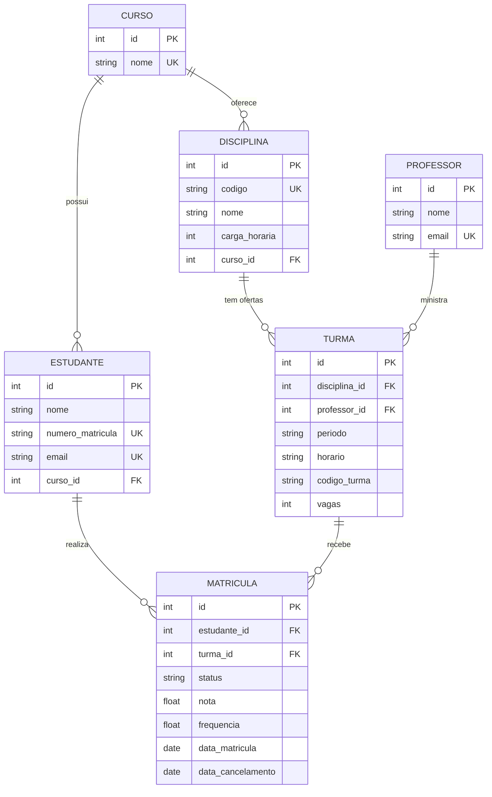

# Sistema de Gestão Acadêmica

API REST para gerenciar **cursos, estudantes, professores, disciplinas, turmas e matrículas** de uma
instituição de ensino superior e gerar o **histórico acadêmico** de cada estudante, preservando os dados de
cada período letivo, das disciplinas cursadas e dos resultados obtidos.

Projeto da disciplina _Desenvolvimento de Software para Persistência_ (Tema 4).

## Sumário

1. [Funcionalidades](#funcionalidades)
2. [Tecnologias](#tecnologias)
3. [Como executar](#como-executar)
4. [Configuração](#configuração)
5. [Migrações (Alembic)](#migrações-alembic)
6. [Modelo de dados](#modelo-de-dados)
7. [Regras de negócio](#regras-de-negócio)
8. [Decisões da equipe](#decisões-da-equipe)
9. [Endpoints](#endpoints)
10. [Exemplo de uso](#exemplo-de-uso)
11. [Códigos de resposta](#códigos-de-resposta)
12. [Estrutura do projeto](#estrutura-do-projeto)
13. [Limitações conhecidas](#limitações-conhecidas)

## Funcionalidades

- CRUD de cursos, estudantes, professores, disciplinas e turmas.
- Matrícula de estudantes em turmas, com bloqueio de duplicidade e de turma lotada.
- Cancelamento de matrícula preservando o registro e liberando a vaga.
- Lançamento de nota e frequência e encerramento da matrícula como **aprovada** ou **reprovada**.
- Histórico acadêmico do estudante, incluindo reprovações e cancelamentos.
- Consultas da coordenação: estudantes de uma turma, oferta de um período, professores responsáveis e
  resultados por turma.
- Controle de vagas por turma (totais, ocupadas e disponíveis).

## Tecnologias

Python 3.10+, FastAPI, SQLModel (SQLAlchemy + Pydantic), SQLite, Alembic e Uvicorn.

## Como executar

```bash
# 1. Criar e ativar o ambiente virtual
python -m venv .venv
.venv\Scripts\activate           # Windows (PowerShell/CMD)
# source .venv/bin/activate      # Linux/macOS

# 2. Instalar as dependências
pip install -r requirements.txt

# 3. (Opcional) criar o arquivo de configuração local
copy .env.example .env           # Windows  (Linux/macOS: cp .env.example .env)

# 4. Criar as tabelas
alembic upgrade head

# 5. Subir a API
uvicorn app.main:app --reload
```

- API: http://127.0.0.1:8000
- Documentação interativa (Swagger): http://127.0.0.1:8000/docs

> A API **não cria tabelas sozinha**. Sempre rode `alembic upgrade head` antes de subir (e depois de
> baixar novas migrações).

## Configuração

Definida em `app/config.py`. Cada valor é lido, nesta ordem de prioridade, de: variável de ambiente,
arquivo `.env` e valor padrão. A API e o Alembic usam a **mesma** `DATABASE_URL`.

| Variável       | Padrão                     | Descrição                                      |
| -------------- | -------------------------- | ---------------------------------------------- |
| `DATABASE_URL` | `sqlite:///./academica.db` | URL do banco de dados                          |
| `DEBUG`        | `false`                    | Se `true`, imprime o SQL executado no terminal |
| `APP_TITLE`    | `Gestão Acadêmica`         | Título exibido na documentação                 |
| `APP_VERSION`  | `1.0.0`                    | Versão da API                                  |

O arquivo `.env` não é versionado; use `.env.example` como modelo.

## Migrações (Alembic)

```bash
alembic upgrade head                              # aplica todas as migrações
alembic current                                   # mostra a versão atual do banco
alembic downgrade base                            # desfaz todas as migrações
alembic revision --autogenerate -m "descrição"    # gera migração após alterar um model
```

- A revisão inicial (`57421ae243a5`) cria as seis tabelas do sistema.
- Após gerar uma migração, **abra o arquivo** em `alembic/versions/` e confira o conteúdo: um `upgrade()`
  vazio significa que o banco já estava igual aos models.
- Os arquivos de `alembic/versions/` devem ser commitados.
- O SQLite usa `render_as_batch=True` (necessário para `ALTER TABLE`).

## Modelo de dados



`MATRICULA` liga `ESTUDANTE` e `TURMA` (relação N:N) e tem restrição única em `(estudante_id, turma_id)`.
Status possíveis: `ATIVA`, `CANCELADA`, `APROVADA`, `REPROVADA`.

**Como o modelo atende o enunciado**

| Necessidade                                                      | Solução                                                                                          |
| ---------------------------------------------------------------- | ------------------------------------------------------------------------------------------------ |
| Separar dados permanentes da disciplina dos dados de cada oferta | `DISCIPLINA` guarda o permanente; cada oferta (período, professor, horário, vagas) é uma `TURMA` |
| Histórico preserva a oferta cursada                              | A matrícula aponta para a **turma**, não para a disciplina                                       |
| Refazer disciplina reprovada, mantendo os dois registros         | Duas matrículas, em turmas diferentes da mesma disciplina                                        |
| Cancelamento sem perder informação                               | A matrícula permanece, com `status = CANCELADA` e `data_cancelamento`                            |
| Evitar matrícula duplicada                                       | Restrição única `(estudante_id, turma_id)` e validação no service                                |

## Regras de negócio

| Regra                                                                                    | Onde é aplicada                         |
| ---------------------------------------------------------------------------------------- | --------------------------------------- |
| Um estudante não pode ter duas matrículas na mesma turma                                 | `matricular` + restrição única no banco |
| Uma turma não pode ter mais matrículas que vagas; turma lotada bloqueia novas matrículas | `matricular`                            |
| Vagas ocupadas = matrículas `ATIVA`, `APROVADA` e `REPROVADA`                            | `contar_vagas_ocupadas`                 |
| Cancelar não apaga a matrícula; muda o status e libera a vaga                            | `cancelar_matricula`                    |
| Só matrículas `ATIVA` podem ser canceladas, receber nota/frequência ou ser encerradas    | services de matrícula                   |
| Um estudante não pode ter duas matrículas `ATIVA` na mesma disciplina                    | `matricular`                            |
| Aprovado = nota ≥ 7,0 **e** frequência ≥ 75%; caso contrário, reprovado                  | `encerrar_matricula`                    |
| Nota entre 0 e 10; frequência entre 0 e 100                                              | schema e `lancar_desempenho`            |
| O histórico inclui reprovações e cancelamentos, ordenado por período                     | `gerar_historico`                       |
| Registros com vínculos não podem ser removidos (erro 409)                                | routers de remoção                      |

## Decisões da equipe

| Decisão                                           | Escolha                                                                                                                                                                                            |
| ------------------------------------------------- | -------------------------------------------------------------------------------------------------------------------------------------------------------------------------------------------------- |
| Matrícula cancelada ocupa vaga?                   | **Não.** A vaga é liberada.                                                                                                                                                                        |
| Critério de aprovação                             | **Nota ≥ 7,0 e frequência ≥ 75%** (frequência em percentual, de 0 a 100).                                                                                                                          |
| Status de matrícula                               | `ATIVA`, `CANCELADA`, `APROVADA`, `REPROVADA`.                                                                                                                                                     |
| Matricular em turma de período encerrado?         | **Não validado.** O período é apenas um texto (ex.: `2026.1`); o modelo não registra se está encerrado.                                                                                            |
| Cancelar matrícula já aprovada ou reprovada?      | **Não.** Só matrículas `ATIVA` podem ser canceladas.                                                                                                                                               |
| Duas turmas da mesma disciplina no mesmo período? | A **instituição pode** criá-las. O **estudante** não pode ter duas matrículas `ATIVA` na mesma disciplina; a regra considera só matrículas ativas, para permitir refazer uma disciplina reprovada. |
| Matricular de novo na mesma turma após cancelar?  | **Não.** A restrição única `(estudante, turma)` bloqueia; o registro cancelado é mantido.                                                                                                          |
| Remover registros com vínculos                    | **Bloqueado** com erro 409. As chaves estrangeiras do SQLite são ativadas em `app/database.py`.                                                                                                    |

## Endpoints

Documentação completa e interativa em `/docs`.

### Cursos

| Método | Rota           | Descrição                                                     |
| ------ | -------------- | ------------------------------------------------------------- |
| POST   | `/cursos/`     | Criar curso                                                   |
| GET    | `/cursos/`     | Listar cursos                                                 |
| GET    | `/cursos/{id}` | Buscar curso                                                  |
| PATCH  | `/cursos/{id}` | Atualizar curso                                               |
| DELETE | `/cursos/{id}` | Remover curso (bloqueado se houver estudantes ou disciplinas) |

### Estudantes

| Método | Rota                         | Descrição                                          |
| ------ | ---------------------------- | -------------------------------------------------- |
| POST   | `/estudantes/`               | Criar estudante (informando o curso)               |
| GET    | `/estudantes/`               | Listar estudantes                                  |
| GET    | `/estudantes/{id}`           | Buscar estudante                                   |
| PUT    | `/estudantes/{id}`           | Atualizar estudante (campos enviados)              |
| DELETE | `/estudantes/{id}`           | Remover estudante (bloqueado se houver matrículas) |
| GET    | `/estudantes/{id}/historico` | **Histórico acadêmico**                            |

### Professores

| Método | Rota                | Descrição                                      |
| ------ | ------------------- | ---------------------------------------------- |
| POST   | `/professores/`     | Criar professor                                |
| GET    | `/professores/`     | Listar professores                             |
| GET    | `/professores/{id}` | Buscar professor                               |
| PUT    | `/professores/{id}` | Atualizar professor (campos enviados)          |
| DELETE | `/professores/{id}` | Remover professor (bloqueado se houver turmas) |

### Disciplinas

| Método | Rota                       | Descrição                                       |
| ------ | -------------------------- | ----------------------------------------------- |
| POST   | `/disciplinas/`            | Criar disciplina                                |
| GET    | `/disciplinas/`            | Listar disciplinas                              |
| GET    | `/disciplinas/{id}`        | Buscar disciplina                               |
| PUT    | `/disciplinas/{id}`        | Atualizar disciplina                            |
| DELETE | `/disciplinas/{id}`        | Remover disciplina (bloqueado se houver turmas) |
| GET    | `/disciplinas/{id}/turmas` | Turmas da disciplina                            |

### Turmas

| Método | Rota                      | Descrição                                                    |
| ------ | ------------------------- | ------------------------------------------------------------ |
| POST   | `/turmas/`                | Criar turma (disciplina, professor, período, horário, vagas) |
| GET    | `/turmas/`                | Listar turmas                                                |
| GET    | `/turmas/{id}`            | Buscar turma (com vagas ocupadas e disponíveis)              |
| PUT    | `/turmas/{id}`            | Atualizar turma                                              |
| DELETE | `/turmas/{id}`            | Remover turma (bloqueado se houver matrículas)               |
| GET    | `/turmas/{id}/estudantes` | Estudantes matriculados                                      |
| GET    | `/turmas/{id}/vagas`      | Vagas totais, ocupadas e disponíveis                         |

### Matrículas

| Método | Rota                        | Descrição                                                                                                     |
| ------ | --------------------------- | ------------------------------------------------------------------------------------------------------------- |
| POST   | `/matriculas/`              | Matricular estudante em turma                                                                                 |
| GET    | `/matriculas/`              | Listar. Filtros: `estudante_id`, `turma_id`, `periodo`, `status`, `limite` (1–100, padrão 50), `deslocamento` |
| GET    | `/matriculas/{id}`          | Buscar matrícula                                                                                              |
| PATCH  | `/matriculas/{id}`          | Lançar nota e/ou frequência                                                                                   |
| POST   | `/matriculas/{id}/cancelar` | Cancelar matrícula                                                                                            |
| POST   | `/matriculas/{id}/encerrar` | Encerrar como aprovada ou reprovada                                                                           |

### Coordenação

| Método | Rota                                        | Descrição                                           |
| ------ | ------------------------------------------- | --------------------------------------------------- |
| GET    | `/coordenacao/turmas/{id}/estudantes`       | Estudantes da turma (filtro opcional `status`)      |
| GET    | `/coordenacao/oferta?periodo=2026.1`        | Disciplinas e turmas oferecidas no período          |
| GET    | `/coordenacao/turmas/{id}/professor`        | Professor responsável pela turma                    |
| GET    | `/coordenacao/disciplinas/{id}/professores` | Professores que ministraram a disciplina            |
| GET    | `/coordenacao/turmas/{id}/resultados`       | Aprovados, reprovados, cancelados e ativos da turma |

## Exemplo de uso

Fluxo completo, na ordem. Corpos em JSON:

```text
POST /cursos/            {"nome": "Sistemas de Informação"}
POST /professores/       {"nome": "Prof. Silva", "email": "silva@ufc.br"}
POST /disciplinas/       {"codigo": "SI01", "nome": "Banco de Dados", "carga_horaria": 64, "curso_id": 1}
POST /estudantes/        {"nome": "Ana", "numero_matricula": "101", "email": "ana@ufc.br", "curso_id": 1}
POST /turmas/            {"disciplina_id": 1, "professor_id": 1, "periodo": "2026.1",
                          "horario": "Seg 08:00", "codigo_turma": "T01", "vagas": 30}

POST /matriculas/        {"estudante_id": 1, "turma_id": 1}
PATCH /matriculas/1      {"nota": 8.5, "frequencia": 90}
POST /matriculas/1/encerrar        -> status APROVADA
GET  /estudantes/1/historico
GET  /coordenacao/turmas/1/resultados
```

Resposta de `GET /estudantes/1/historico`:

```json
{
  "estudante_id": 1,
  "nome_estudante": "Ana",
  "numero_matricula": "101",
  "curso": "Sistemas de Informação",
  "disciplinas": [
    {
      "periodo": "2026.1",
      "codigo_disciplina": "SI01",
      "nome_disciplina": "Banco de Dados",
      "codigo_turma": "T01",
      "professor": "Prof. Silva",
      "nota": 8.5,
      "frequencia": 90.0,
      "status": "APROVADA"
    }
  ]
}
```

## Códigos de resposta

| Código          | Quando ocorre                                                                                                                                                                           |
| --------------- | --------------------------------------------------------------------------------------------------------------------------------------------------------------------------------------- |
| 200 / 201 / 204 | Sucesso (consulta/alteração, criação, remoção)                                                                                                                                          |
| 400             | Dado inválido para a operação (nota/frequência fora da faixa, campo obrigatório nulo, encerrar sem nota ou frequência)                                                                  |
| 404             | Registro não encontrado (estudante, turma, matrícula, curso etc.)                                                                                                                       |
| 409             | Conflito com o estado atual (matrícula duplicada, turma lotada, matrícula ativa na mesma disciplina, registro duplicado, remoção com vínculos, ação sobre matrícula que não está ativa) |
| 422             | Corpo da requisição inválido (validação do Pydantic)                                                                                                                                    |
| 500             | Inconsistência de dados no banco                                                                                                                                                        |

## Estrutura do projeto

```text
app/
  config.py        configurações (DATABASE_URL, DEBUG, ...)
  database.py      engine, sessão e ativação das chaves estrangeiras (SQLite)
  main.py          aplicação FastAPI e registro dos routers
  models/          tabelas (SQLModel)
  schemas/         modelos de entrada e saída da API
  services/        regras de negócio: matricula_service, historico_service, coordenacao_service
  routers/         endpoints de cada módulo
alembic/           configuração e versões das migrações
alembic.ini
requirements.txt
.env.example
```

## Limitações conhecidas

- A checagem de vagas não é atômica: dois pedidos simultâneos para a última vaga podem ultrapassar o limite.
- O período letivo é um texto livre; não há controle de período aberto ou encerrado.
- A listagem de matrículas é paginada (padrão de 50 itens); as demais listagens devolvem todos os registros.
- A oferta do período consulta as vagas turma a turma (uma contagem por turma).
